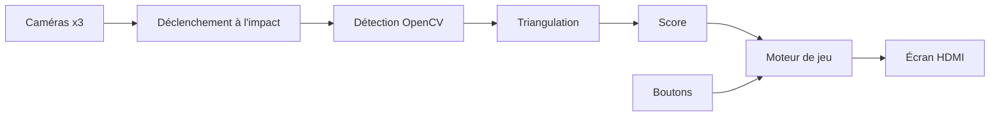

# Dartagnan

Système de comptage automatique pour cible de fléchettes classique. Projet d'école d'ingénieurs (JUNIA ISEN), pédagogique et non destiné à la commercialisation.

Trois caméras placées autour de la cible détectent l'impact de chaque fléchette. Le système calcule sa position et le score, puis affiche la partie sur un écran relié à la Raspberry Pi, piloté par des boutons physiques. Tout fonctionne en local, sans abonnement ni connexion Internet.

## Jalons

| Jalon | Date | Contenu |
|---|---|---|
| Soutenance N°2 | 1-2 déc. 2026 | Détection, score 301 en solo, affichage temps réel |
| Release 1 (MVP) | Janvier 2027 | Partie de 301 à deux joueurs de bout en bout, sans saisie manuelle |
| Release 2 (soutenance finale) | Mi-mars 2027 environ | Cricket et autres modes, jusqu'à 8 joueurs, moins de 500 ms entre l'impact et l'affichage |

## Matériel

- **Unité de calcul** : Raspberry Pi 4 Model B 8 Go (arm64).
- **Caméras** : 3 modules USB OV9732, 720p à 30 fps, objectif fixe 100°, UVC. Branchées sur un hub USB relié à un seul port de la Pi, format MJPEG forcé (le YUY2 sature l'USB 2.0). Trois flux MJPEG 1280 × 720 à 30 fps simultanés validés sur Pi 4 via le hub (capture seule avec `v4l2-ctl`, sans traitement).
- **Éclairage** : bandeau LED blanc autour de la cible, alimenté en USB, sans pilotage logiciel.
- **Affichage** : écran 24 pouces 1920 × 1080 relié au port micro-HDMI de la Pi, avec boutons physiques. Câblage des boutons à confirmer.
- **Structure** : arceau caméras et anneau LED imprimés en 3D.

## Chaîne logicielle

Python et OpenCV. La détection repose sur du traitement d'image classique, sans modèle entraîné.



- **Déclenchement** : la détection ne tourne que lorsqu'une fléchette vient de se planter (arrêt du mouvement), pour limiter la charge CPU.
- **Détection** : localisation de la pointe dans chaque image. Méthode à confirmer.
- **Triangulation** : correction de la distorsion de chaque caméra (calibration intrinsèque), puis combinaison des trois vues pour obtenir la position de la pointe sur la cible.
- **Score** : calculé à partir de l'angle et de la distance au centre.

## Calcul du score

Rayons en mm depuis le centre : simple bull (50) de 0 à 6,35, bull extérieur (25) de 6,35 à 15,9, triple de 99 à 107, double de 162 à 170, hors cible au-delà de 170.

Secteurs dans le sens horaire depuis le haut, 18° chacun, le 20 étant centré sur la verticale :

```
20, 1, 18, 4, 13, 6, 10, 15, 2, 17, 3, 19, 7, 16, 8, 11, 14, 9, 12, 5
```

## Règles du 301

- Chaque joueur part de 301 et lance 3 fléchettes par tour. Le score de chaque fléchette est soustrait.
- Il faut atteindre exactement 0. En cas de dépassement (bust), le score revient à sa valeur du début du tour.
- Sortie choisie au lancement de la partie : sortie simple, ou double out (finir sur un double ou le Bull ; rester à 1 est un bust).
- Une correction manuelle d'un lancer reste possible.

## Application (MVP)

Application pygame plein écran sur l'écran HDMI, pilotée par trois boutons : Gauche, Droite, Valider.

| Geste sur Valider | Dans les menus | Pendant la partie |
|---|---|---|
| Appui court | Valider | Simple |
| Deux appuis rapides | Valider | Double |
| Appui long (0,6 s) | Retour | Triple |

- **Comptes** : pseudo (3 à 16 caractères) et code PIN de 4 à 6 chiffres, composés aux boutons. Le joueur 2 est choisi dans la liste des comptes, sans code.
- **Partie** : 301 en solo ou à deux. Pavé de saisie : 1 à 20, 25, Bull, Raté, Annuler (dernière fléchette), Quitter.
- **Mes parties** : historique et détail de chaque volée. **Profil** : parties jouées, victoires à deux, moyenne par volée, meilleure volée.
- **Calibration** : maquette, en attendant la chaîne caméras.
- **Charte graphique** JUNIA : violet `#3F2A56` dominant, orange `#FF5C39` pour la sélection, police Montserrat, logo blanc sur fond violet.

Sécurité :

- Code PIN jamais stocké en clair : empreinte scrypt avec sel aléatoire par compte. Compte bloqué 5 minutes après 5 codes faux.
- Requêtes SQL paramétrées, saisies validées (caractères autorisés, longueurs).
- Base SQLite `/var/lib/dartagnan/dartagnan.db` lisible par le seul utilisateur `dartagnan` (dossier en 700, fichier en 600).
- Déconnexion automatique après 5 minutes sans appui, hors partie en cours.
- Service systemd durci : pas d'élévation de privilèges, système en lecture seule sauf `/var/lib/dartagnan`.

Versions figées : celles de Debian Trixie sur la Pi (Python 3.13, pygame 2.6.1, pytest 8.3.5), reprises à l'identique dans `requirements-dev.txt` pour le développement sur PC. `install.sh` signale une version de pygame ou d'OpenCV différente.

## Développement sur PC

Python 3.13 requis (celui de la Pi). Les boutons sont simulés au clavier : flèches Gauche / Droite, Entrée ou Espace pour Valider, Échap pour quitter. Le jeu s'ouvre dans une fenêtre de 960 × 540 redimensionnable.

Sous Windows (PowerShell) :

```powershell
py -3.13 -m venv .venv
.venv\Scripts\python -m pip install -r requirements-dev.txt
$env:PYTHONPATH="src"; $env:DARTAGNAN_DATA="data"
.venv\Scripts\python -m dartagnan
.venv\Scripts\python -m pytest
```

Sous Linux ou macOS :

```sh
python3.13 -m venv .venv
.venv/bin/pip install -r requirements-dev.txt
DARTAGNAN_DATA=data PYTHONPATH=src .venv/bin/python -m dartagnan
.venv/bin/python -m pytest
```

Caméras branchées sur le PC par le hub USB : désignées par leur numéro Windows (`0`, `1`, `2`), dont l'ordre peut changer d'un branchement à l'autre ; la webcam intégrée du PC en occupe un. Dans PowerShell, après les deux variables d'environnement ci-dessus :

```powershell
.venv\Scripts\python tools\camera_preview.py 1 2 3
.venv\Scripts\python tools\calibrate_board.py 1 2 3 --top 180 54 306
```

Sur la Pi, depuis `/opt/dartagnan`, affichage des caméras sur l'écran :

```sh
PYTHONPATH=src SDL_VIDEODRIVER=kmsdrm .venv/bin/python tools/camera_preview.py
```

`calibrate_board.py` : 4 points par caméra sur le bord extérieur du double (limites 20|1, 6|10, 3|19, 11|14), grille de la cible projetée sur l'image, zone visée affichée sous la souris. Résultat dans `data/calibration.json`, photos des caméras (touche P) dans `data/captures/`. Distorsion de l'objectif pas encore corrigée. Procédure de test avec les caméras et résultats attendus : [docs/test-calibration.md](docs/test-calibration.md).

Touche A : détection automatique par les couleurs des anneaux double et triple (`geometry/auto_calibration.py`). Sans point placé, la cible est trouvée seule si l'angle donné par `--top` (un par caméra, 0 par défaut : le 20) est à moins de 18° du haut de l'image ; caméras au droit du 20, du 16 et du 15 : `--top 180 54 306` ; avec 4 points placés, même approximatifs, ils sont recalés. Hypothèse : cible rouge et verte, double et triple du 20 en rouge.

Simulation sans matériel (caméras virtuelles, images de synthèse) : environnement séparé dans le dossier `simulation/`, branche `feat/simulation`, avec ses hypothèses, résultats et limites dans `simulation/README.md`.

Détection sur photos réelles, sans cible ni caméras : séries de photos des trois caméras et zones réelles dans `photos/`, mesure par `tools/detect_photos.py`, enregistrement de nouvelles volées avec affichage en direct des caméras et des impacts par `tools/record_volleys.py` (mode d'emploi dans `photos/README.md`).

## Système

- Raspberry Pi OS Lite 64 bits (Trixie, Debian 13), configurée par `system/install.sh`, script unique et rejouable.
- OpenCV et pygame installés depuis les paquets de l'OS, utilisés dans un environnement virtuel (`/opt/dartagnan/.venv`).
- Affichage par pygame directement sur l'écran (KMS/DRM), sans environnement de bureau.
- Démarrage automatique par le service systemd `dartagnan`. Données persistantes dans `/var/lib/dartagnan`.
- Caméras identifiées par leur port USB physique (`/dev/v4l/by-path`), jamais par `/dev/videoN`.
- Pas de Docker ni de conteneurs dans le produit livré.
- Une image système prête à flasher sera produite en fin de projet, à partir du même script.

## Réseau

| Accès | Usage | Adresse de la Pi |
|---|---|---|
| Wi-Fi domestique (box du client) ou partage de connexion d'un téléphone | Internet : installation, mises à jour | `dartagnan.local` |
| Câble Ethernet direct avec un PC | Développement, secours | `192.168.77.1` |
| Point d'accès Wi-Fi `Dartagnan`, créé si aucun Wi-Fi connu | Développement, secours | `10.42.0.1` |

Le Wi-Fi doit être protégé par un simple mot de passe, sans portail captif. Le Wi-Fi de l'école n'est pas utilisé (portail captif, enregistrement d'adresse MAC impossible).

## Installation

Préparation de la carte SD avec Raspberry Pi Imager, connexion à la Pi, installation et configuration : [docs/installation.md](docs/installation.md).

Mise à jour du jeu, Internet requis : `sudo /opt/dartagnan/system/update.sh`.

## Organisation du dépôt

Proposée, à valider par l'équipe. Le dossier `detection` reste à créer.

| Chemin | Contenu |
|---|---|
| `src/dartagnan/capture` | Acquisition des caméras et sources simulées |
| `src/dartagnan/detection` | Déclenchement et détection OpenCV |
| `src/dartagnan/geometry` | Calibration, triangulation, calcul du score |
| `src/dartagnan/game` | Règles du 301 et des autres modes |
| `src/dartagnan/storage` | Base SQLite : comptes, historique, statistiques |
| `src/dartagnan/display` | Affichage sur l'écran, boutons physiques et écrans de l'application |
| `system` | Script d'installation et services |
| `docs` | Documentation (installation) |
| `simulation` | Environnement de simulation séparé du jeu (branche `feat/simulation`) |
| `photos` | Photos réelles des trois caméras et zones réelles, pour tester la détection |
| `tests` | Tests unitaires |

## Points ouverts

- Développement from scratch ou réutilisation de la pile open source Autodarts : décision client.
- Machine finale : Raspberry Pi 4 (disponible) ou Raspberry Pi 5 (demandée au client).
- Câblage des trois boutons (GPIO ou boîtier USB) : simulés au clavier en attendant, dans `display/buttons.py` et `display/app.py`.
