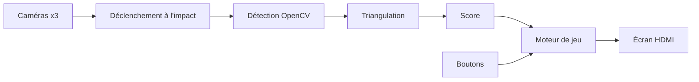

# Dartagnan

Système de comptage automatique pour cible de fléchettes classique. Projet d'école d'ingénieurs (JUNIA ISEN), pédagogique et non destiné à la commercialisation.

Trois caméras placées autour de la cible détectent l'impact de chaque fléchette. Le système calcule sa position et le score, puis affiche la partie sur un écran relié à la Raspberry Pi, piloté par des boutons physiques. Tout fonctionne en local, sans abonnement ni connexion Internet.

## Jalons

| Jalon | Date | Contenu |
|---|---|---|
| Soutenance N°2 | 1-2 déc. 2026 | Détection, score 301 en solo, affichage temps réel |
| Release 1 (MVP) | Janvier 2027 | Partie de 301 à deux joueurs de bout en bout, sans saisie manuelle |
| Release 2 (soutenance finale) | Mi-mars 2027 environ | Cricket et autres modes, jusqu'à 8 joueurs, moins de 500 ms entre l'impact et l'affichage |

## Matériel

- **Unité de calcul** : Raspberry Pi 4 Model B 8 Go (arm64).
- **Caméras** : 3 modules USB OV9732, 720p à 30 fps, objectif fixe 100°, UVC. Une caméra par port USB physique, format MJPEG forcé (le YUY2 sature l'USB 2.0).
- **Éclairage** : bandeau LED blanc autour de la cible, alimenté en USB, sans pilotage logiciel.
- **Affichage** : écran 24 pouces 1920 × 1080 relié au port micro-HDMI de la Pi, avec boutons physiques. Câblage des boutons à confirmer.
- **Structure** : arceau caméras et anneau LED imprimés en 3D.

## Chaîne logicielle

Python et OpenCV. La détection repose sur du traitement d'image classique, sans modèle entraîné.



- **Déclenchement** : la détection ne tourne que lorsqu'une fléchette vient de se planter (arrêt du mouvement), pour limiter la charge CPU.
- **Détection** : localisation de la pointe dans chaque image. Méthode à confirmer.
- **Triangulation** : correction de la distorsion de chaque caméra (calibration intrinsèque), puis combinaison des trois vues pour obtenir la position de la pointe sur la cible.
- **Score** : calculé à partir de l'angle et de la distance au centre.

## Calcul du score

Rayons en mm depuis le centre : simple bull (50) de 0 à 6,35, bull extérieur (25) de 6,35 à 15,9, triple de 99 à 107, double de 162 à 170, hors cible au-delà de 170.

Secteurs dans le sens horaire depuis le haut, 18° chacun, le 20 étant centré sur la verticale :

```
20, 1, 18, 4, 13, 6, 10, 15, 2, 17, 3, 19, 7, 16, 8, 11, 14, 9, 12, 5
```

## Règles du 301

- Chaque joueur part de 301 et lance 3 fléchettes par tour. Le score de chaque fléchette est soustrait.
- Il faut atteindre exactement 0. En cas de dépassement (bust), le score revient à sa valeur du début du tour.
- Une correction manuelle d'un lancer reste possible.

## Système

- Raspberry Pi OS Lite 64 bits (Trixie, Debian 13), configurée par `system/install.sh`, script unique et rejouable.
- OpenCV et pygame installés depuis les paquets de l'OS, utilisés dans un environnement virtuel (`/opt/dartagnan/.venv`).
- Affichage par pygame directement sur l'écran (KMS/DRM), sans environnement de bureau.
- Démarrage automatique par le service systemd `dartagnan`. Données persistantes dans `/var/lib/dartagnan`.
- Caméras identifiées par leur port USB physique (`/dev/v4l/by-path`), jamais par `/dev/videoN`.
- Pas de Docker ni de conteneurs dans le produit livré.
- Une image système prête à flasher sera produite en fin de projet, à partir du même script.

## Réseau

La Pi reste joignable sans dépendre du réseau du lieu. Le Wi-Fi de l'école n'est pas utilisé (portail captif, enregistrement d'adresse MAC impossible).

| Accès | Usage | Adresse de la Pi |
|---|---|---|
| Câble Ethernet direct avec un PC | Développement, secours | `192.168.77.1` |
| Point d'accès Wi-Fi `Dartagnan` | Développement, secours | `10.42.0.1` |
| Partage de connexion d'un téléphone | Internet : installation, mises à jour | Attribuée par le téléphone, ou `dartagnan.local` |

- Ethernet : la Pi distribue une adresse au PC. Ce port est réservé au câble direct : ne pas le brancher sur un réseau existant, la Pi y distribuerait aussi des adresses.
- Point d'accès : créé si aucun Wi-Fi connu n'est connecté 45 s après le démarrage. Pour revenir à un Wi-Fi connu, redémarrer la Pi à portée de ce réseau.
- Mot de passe du point d'accès : demandé au premier lancement de `install.sh`, stocké uniquement sur la Pi. Le changer : `sudo nmcli connection modify dartagnan-ap wifi-sec.psk "<nouveau>"`.
- Ajouter un Wi-Fi connu : `sudo nmcli device wifi connect "<nom>" password "<mot de passe>"`.

## Installation sur la Raspberry Pi

Carte SD préparée avec Raspberry Pi Imager : Raspberry Pi OS Lite 64 bits, nom d'hôte `dartagnan`, utilisateur `dartagnan`, SSH activé avec authentification par mot de passe (accès de secours si une clé manque dans `system/authorized_keys`), Wi-Fi du partage de connexion d'un téléphone.

Depuis un poste connecté au même partage de connexion :

```sh
ssh dartagnan@dartagnan.local
sudo apt-get update && sudo apt-get install -y git
sudo install -d -o dartagnan -g dartagnan /opt/dartagnan
git clone https://github.com/PierreChtimipi/Dartagnan.git /opt/dartagnan
sudo /opt/dartagnan/system/install.sh
sudo reboot
```

- Mise à jour du jeu, Internet requis : `sudo /opt/dartagnan/system/update.sh` récupère la dernière version de `main`, relance `install.sh` et redémarre le jeu.
- Accès SSH : ajouter sa clé publique dans `system/authorized_keys`, puis relancer `install.sh`.

## Organisation du dépôt

Proposée, à valider par l'équipe :

| Chemin | Contenu |
|---|---|
| `src/dartagnan/capture` | Acquisition des caméras et sources simulées |
| `src/dartagnan/detection` | Déclenchement et détection OpenCV |
| `src/dartagnan/geometry` | Calibration, triangulation, calcul du score |
| `src/dartagnan/game` | Règles du 301 et des autres modes |
| `src/dartagnan/display` | Affichage sur l'écran et boutons physiques |
| `system` | Script d'installation et services |
| `tests` | Tests unitaires |

## Points ouverts

- Développement from scratch ou réutilisation de la pile open source Autodarts : décision client.
- Machine finale : Raspberry Pi 4 (disponible) ou Raspberry Pi 5 (demandée au client).
- Règles d'entrée et de sortie du 301 (double out ou sortie simple).
