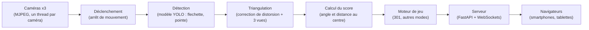

# Dartagnan

Système de comptage automatique pour cible de fléchettes classique, développé dans le cadre d'un projet d'école d'ingénieurs (JUNIA ISEN).

## Sommaire

- [Présentation](#présentation)
- [Équipe et parties prenantes](#équipe-et-parties-prenantes)
- [Organisation et jalons](#organisation-et-jalons)
- [Périmètre](#périmètre)
- [Matériel](#matériel)
- [Chaîne logicielle](#chaîne-logicielle)
- [Géométrie de la cible et calcul du score](#géométrie-de-la-cible-et-calcul-du-score)
- [Règles du 301](#règles-du-301)
- [Système et déploiement](#système-et-déploiement)
- [Réseau et multi-cibles](#réseau-et-multi-cibles)
- [Charte graphique](#charte-graphique)
- [Budget](#budget)
- [Organisation du dépôt](#organisation-du-dépôt)
- [Prérequis](#prérequis)
- [Points ouverts](#points-ouverts)

## Présentation

Dartagnan compte automatiquement les points sur une cible de fléchettes classique. Trois caméras placées autour de la cible observent chaque impact ; le système calcule la position de la fléchette, en déduit le score et met à jour la partie. L'état de la partie s'affiche en temps réel sur les smartphones ou tablettes des joueurs, via une interface web servie localement.

Positionnement :

- accessible et peu coûteux, sans abonnement ;
- fonctionnement entièrement local, sur du matériel grand public, sans cloud ni connexion Internet ;
- ces deux points le distinguent des solutions existantes Scolia et Autodarts.

Dartagnan est un projet pédagogique. Il n'est pas destiné à la commercialisation.

Licence du code : à confirmer.

## Équipe et parties prenantes

### Équipe

Cinq étudiants apprentis, en alternance école / entreprise.

| Membre | Rôle | Responsabilités |
|---|---|---|
| Sacha Bouton | Product Owner | Vision, backlog, priorisation, relation client, développement |
| Paul Cislini | Scrum Master | Rituels, suivi, blocages, intégration et tests, développement |
| Clément Flament | Référent vision | Calibration, détection, triangulation, mapping |
| Pierre Foulon | Référent application | Règles du 301, interface, affichage, correction des scores |
| Cyril Decaudin | Référent intégration | Impression 3D, montage, éclairage, câblage, Raspberry Pi |

Planning, budget, état de l'art et soutenances sont portés collectivement, pilotés par le Product Owner et le Scrum Master.

### Parties prenantes

| Partie prenante | Rôle |
|---|---|
| M. Stéphane Fardoux | Client et encadrant, à l'origine du projet. Valide et passe les achats (uniquement sur Amazon). |
| Guillaume Poirrier, Mathilde Bogaert, Antoine Comble (Zenika) | Présents aux soutenances |
| Maison ISEN | Impression 3D (gratuite pour l'équipe) et locaux |
| Association fléchettes ISEN, étudiants et personnels | Utilisateurs finaux et testeurs |

## Organisation et jalons

- Sprints de 2 semaines, alignés sur les périodes école. Pas de sprint pendant les périodes entreprise.
- Code hébergé sur GitHub ; backlog et suivi dans GitHub Projects.
- URL du dépôt et du tableau GitHub Projects : à confirmer.

| Jalon | Date | Contenu attendu |
|---|---|---|
| Soutenance N°1 | 23-24 septembre 2026 | Cadrage |
| Soutenance N°2 | 1-2 décembre 2026 | Incrément de mi-parcours : détection, score 301 en solo, affichage temps réel. Ce n'est pas le MVP. |
| Release 1 (MVP) | Janvier 2027 (date exacte à confirmer) | Une partie de 301 à deux joueurs de bout en bout, sans saisie manuelle |
| Release 2 (soutenance finale) | Mi-mars 2027 environ (date exacte à confirmer) | Cricket et autres modes, jusqu'à 8 joueurs, affichage enrichi, moins de 500 ms entre l'impact et l'affichage |

## Périmètre

Priorisation MoSCoW :

| Priorité | Contenu |
|---|---|
| Must | Le MVP (Release 1) : partie de 301 à deux joueurs de bout en bout, sans saisie manuelle |
| Should | Release 2 : Cricket, jusqu'à 8 joueurs, tablette, LED, latence inférieure à 500 ms |
| Could | Statistiques, historique, heatmap, aide au checkout, calibration automatique |
| Won't | Jeu en ligne, comptes utilisateurs, tournois, cloud (exclus par choix de positionnement) |

## Matériel

### Unité de calcul

- Machine disponible aujourd'hui : Raspberry Pi 4 Model B 8 Go (arm64).
- Historique : un mini-PC HP EliteDesk 800 G3 (Intel i5) avait d'abord été retenu. Un Raspberry Pi 5 8 Go a ensuite été demandé au client ; réponse en attente.
- Conséquence : le code ne doit dépendre d'aucune spécificité x86 / Intel.

### Caméras

Kit de 3 modules USB OV9732 :

- 720p à 30 fps ;
- objectif fixe 100°, focale 2,1 mm ;
- UVC, sans pilote spécifique ;
- câbles de 2 m.

Contraintes connues :

- forcer le format MJPEG : le YUY2 sature le bus USB 2.0 ;
- une caméra par port USB physique ; ne pas utiliser le répartiteur fourni avec le kit ;
- calibration intrinsèque obligatoire avant toute triangulation.

### Éclairage

Bandeau LED adressable WS2812 placé autour de la cible.

- Rôle principal : éclairage maîtrisé pour la détection, avec un flash blanc au moment de la capture.
- Rôle secondaire, après le MVP : indiquer la zone à viser selon le checkout (par exemple double 20 en vert, triple 20 en rouge).
- Bibliothèque de pilotage et broche utilisée (PWM ou SPI) : point ouvert.
- Alimentation du bandeau et nombre de LED : à confirmer.

### Structure

- Cible et fléchettes.
- Mousse de protection.
- Arceau de fixation des caméras et anneau LED imprimés en 3D, dérivés de modèles Autodarts publiés sur Printables. Licence des modèles d'origine et obligations d'attribution : à confirmer.
- Boîtier de gestion des câbles USB.

### Postes non budgétés

- Tablette de commande.
- Sortie audio.
- Écran d'affichage.

## Chaîne logicielle

Langage : Python. Traitement d'image : OpenCV.



### Acquisition

- Un thread de capture par caméra, flux MJPEG.
- Caméras identifiées par leur port USB physique (voir [Système et déploiement](#système-et-déploiement)).

### Déclenchement à l'impact

Le modèle de détection ne tourne pas en continu. Il est déclenché uniquement lorsqu'une fléchette vient de se planter, détecté par l'arrêt du mouvement dans l'image. Ce déclenchement conditionnel est ce qui rend l'exécution sur CPU envisageable.

### Détection

- Modèle YOLO (Ultralytics v8 ou v11 ; version retenue à confirmer).
- Entraîné sur deux classes : `flechette` et `pointe`.
- Dataset (constitution, volume, annotation) : à confirmer.

### Correction de distorsion et triangulation

- Chaque image est corrigée avec les paramètres intrinsèques de sa caméra (`cv2.calibrateCamera` pour l'estimation, puis `undistort`).
- Les trois vues sont ensuite combinées par triangulation pour obtenir la position de la pointe dans le plan de la cible.

### Calcul du score

Le score est déduit de l'angle (`atan2`) et de la distance au centre de la cible. Détail dans [Géométrie de la cible et calcul du score](#géométrie-de-la-cible-et-calcul-du-score).

### Moteur de jeu

Moteur de 301 en premier, puis autres modes (Cricket notamment). Voir [Règles du 301](#règles-du-301).

### Serveur et interface

- Serveur FastAPI ; l'état de la partie est poussé en temps réel vers les navigateurs par WebSockets.
- Technologie de l'interface web (framework éventuel) : à confirmer.

### Runtime d'inférence

OpenVINO était prévu pour le CPU Intel du mini-PC. Sur Raspberry Pi (ARM), le choix reste à faire après benchmark (OpenVINO ARM, NCNN, ONNX Runtime, ou autre). Point ouvert.

## Géométrie de la cible et calcul du score

### Dimensions standard

Rayons mesurés depuis le centre de la cible, en millimètres.

| Zone | Rayon intérieur | Rayon extérieur | Points |
|---|---|---|---|
| Simple bull | 0 | 6,35 | 50 |
| Bull extérieur | 6,35 | 15,9 | 25 |
| Simple (intérieur) | 15,9 | 99 | valeur du secteur |
| Anneau triple | 99 | 107 | 3 x valeur du secteur |
| Simple (extérieur) | 107 | 162 | valeur du secteur |
| Anneau double | 162 | 170 | 2 x valeur du secteur |
| Hors cible | 170 | - | 0 |

Traitement d'un impact situé exactement sur une limite (fil de séparation) : à confirmer.

### Secteurs

Ordre des secteurs dans le sens horaire, en partant du haut :

```
20, 1, 18, 4, 13, 6, 10, 15, 2, 17, 3, 19, 7, 16, 8, 11, 14, 9, 12, 5
```

Chaque secteur couvre 18°. Le secteur 20 est centré sur la verticale.

### Calcul

Pour un impact de coordonnées (x, y) dans le plan de la cible, origine au centre, x vers la droite et y vers le haut :

- distance au centre : r = sqrt(x² + y²) ;
- angle mesuré depuis la verticale, dans le sens horaire : θ = atan2(x, y), ramené dans [0°, 360°[ ;
- indice du secteur dans la liste ci-dessus : floor(((θ + 9°) mod 360°) / 18°), le décalage de 9° venant du centrage du 20 sur la verticale ;
- la distance r détermine la zone (bull, simple, triple, double, hors cible) d'après le tableau des dimensions.

## Règles du 301

- Chaque joueur part de 301.
- Chaque joueur lance 3 fléchettes par tour ; le score de chaque fléchette est soustrait de son total.
- Le joueur doit atteindre exactement 0.
- Dépassement (bust) : le score du joueur revient à sa valeur du début du tour et la main passe au joueur suivant.
- Règle de sortie (double out ou sortie simple) : à confirmer avec le client.
- Règle d'entrée : à confirmer avec le client.
- Une correction manuelle d'un lancer doit rester possible en cas d'erreur de détection.

Règles du Cricket et des autres modes : à confirmer.

## Système et déploiement

### Objectif

Fonctionnement clé en main : l'utilisateur flashe l'image Dartagnan (`.img.xz`) sur la carte de sa Raspberry Pi avec Raspberry Pi Imager, branche le matériel, et le système fonctionne sans aucune configuration.

Le démarrage sur clé USB doit rester possible en l'absence de carte microSD.

### Image système

- Base : Raspberry Pi OS Lite 64 bits. Version de l'OS retenue : à confirmer.
- Un script d'installation unique, rejouable sans effet de bord, transforme une Raspberry Pi OS Lite vierge en borne Dartagnan.
- Ce script est la source de vérité de la configuration système. Il est réutilisé tel quel comme stage pi-gen pour produire l'image distribuable.
- Tout est pré-installé dans l'image (dépendances Python, poids du modèle) : aucun téléchargement au premier lancement.
- Pas de Docker ni de conteneurs dans le produit livré (contrainte client non négociable). Un outil de build peut en utiliser sur la machine de développement, mais rien n'en reste dans l'image.

### Services

- Démarrage automatique par des services systemd.
- Redémarrage automatique en cas de crash (mode borne).

### Caméras

- Identification par le port USB physique, via `/dev/v4l/by-path` et des règles udev.
- Jamais par `/dev/videoN`, dont l'ordre change d'un démarrage à l'autre.

### Système de fichiers

- Racine en lecture seule (overlayfs), pour résister aux coupures de courant.
- Partition de données accessible en écriture pour ce qui doit persister : calibration, configuration.
- Point de montage et taille de la partition de données : à confirmer.

### Calibration

- Calibration intrinsèque : peut être réalisée une fois par caméra.
- Calibration extrinsèque : dépend du montage ; elle nécessite un mode calibration guidé dans l'interface.
- Mire de calibration utilisée (type, dimensions) : à confirmer.

## Réseau et multi-cibles

### Point d'accès Wi-Fi

- La Raspberry Pi crée son propre point d'accès Wi-Fi (profil NetworkManager en mode AP, partage IPv4).
- Aucun accès Internet ni réseau de l'école n'est requis.
- SSID, mot de passe et adresse IP sont fixes et prévisibles, car un QR code imprimé sur le caisson pointe vers l'interface web. Valeurs retenues : à confirmer.

### Plusieurs cibles sur une même machine

- Un processus natif séparé par cible.
- Un port par cible : 8001, 8002, etc.
- Nombre de cibles qu'une même machine peut gérer (ports USB disponibles, à raison d'une caméra par port, et charge CPU) : à confirmer.

## Charte graphique

Couleurs à utiliser pour l'interface web :

| Nom | Code |
|---|---|
| Marine | `#1A1A2E` |
| Rouge | `#E63946` |
| Turquoise | `#2A9D8F` |
| Bleu | `#3E6D9C` |
| Ambre | `#B5761F` |

Attribution des couleurs aux éléments de l'interface et police de caractères : à confirmer.

## Budget

Budget matériel théorique :

| Hypothèse | Montant |
|---|---|
| Raspberry Pi à la charge de l'équipe | environ 327 € |
| Raspberry Pi fournie par le client | environ 127 € |

Les achats sont validés et passés par le client, uniquement sur Amazon. Détail poste par poste : à confirmer. Les postes listés dans [Postes non budgétés](#postes-non-budgétés) ne sont pas inclus.

## Organisation du dépôt

Le dépôt ne contient pas encore de code. Arborescence proposée, à valider par l'équipe :

| Chemin | Contenu |
|---|---|
| `src/dartagnan/capture` | Acquisition des caméras et sources simulées |
| `src/dartagnan/detection` | Déclenchement à l'impact et modèle de détection |
| `src/dartagnan/geometry` | Calibration, triangulation, calcul du score |
| `src/dartagnan/game` | Règles du 301 et des autres modes |
| `src/dartagnan/server` | API FastAPI et WebSockets |
| `src/dartagnan/leds` | Pilotage du bandeau WS2812 |
| `web` | Interface affichée sur les smartphones et tablettes |
| `system` | Script d'installation, unités systemd, règles udev, profil NetworkManager, stage pi-gen |
| `tools` | Scripts de calibration, d'annotation et de benchmark |
| `tests` | Tests unitaires et données de test légères |
| `docs` | Documentation complémentaire |

Les datasets, vidéos de test et poids du modèle ne sont pas versionnés dans git sans décision explicite (voir [Points ouverts](#points-ouverts)).

## Prérequis

### Machine de développement

- Système d'exploitation : indifférent a priori ; à confirmer selon les outils retenus (notamment pour la construction de l'image pi-gen).
- Git et un accès au dépôt GitHub de l'équipe.
- Les sources simulées (vidéos ou images enregistrées) doivent permettre de développer sans la Raspberry Pi ni les caméras.

### Python

- Version : celle fournie par Raspberry Pi OS 64 bits ; numéro exact à confirmer.
- Environnement virtuel et dépendances épinglées.
- Outils : ruff (lint et formatage), pytest (tests).
- Commandes d'installation et de lancement : à compléter quand le code et le fichier de dépendances existeront.

### Accès à la Raspberry Pi

- Matériel de référence : Raspberry Pi 4 Model B 8 Go, trois caméras OV9732 branchées chacune sur un port USB distinct.
- Mode d'accès pour le développement (SSH, réseau utilisé, identifiants) : à compléter.
- Procédure de flashage d'une image de développement : à compléter.

## Points ouverts

Les points suivants ne sont pas tranchés. Toute décision est reportée dans ce document.

- Développement from scratch ou réutilisation de la pile open source Autodarts : décision du client.
- Machine finale : Raspberry Pi 4 8 Go (disponible) ou Raspberry Pi 5 8 Go (demandée au client).
- Runtime d'inférence sur ARM et respect de l'objectif de latence : à mesurer sur la Raspberry Pi.
- Règles d'entrée et de sortie du 301.
- Affichage : interface web sur smartphone / tablette uniquement, ou écran physique fixé près de la cible avec boutons (piste étudiée avec une Raspberry Pi Zero W).
- Pilotage des WS2812 depuis la Raspberry Pi : bibliothèque et broche (PWM ou SPI) à choisir.
- Stockage des datasets et des poids du modèle : hors git, Git LFS ou releases GitHub.
